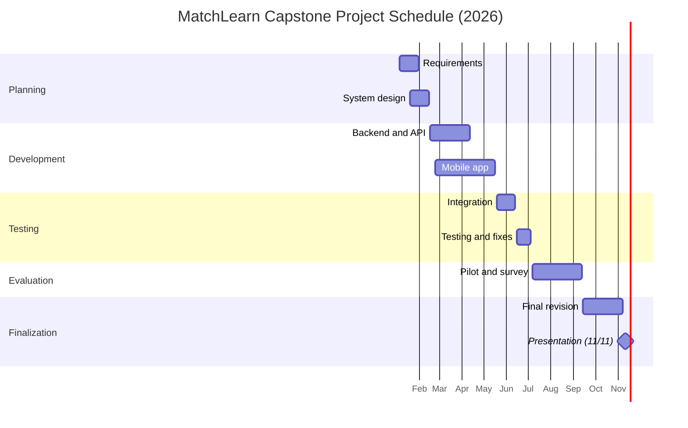
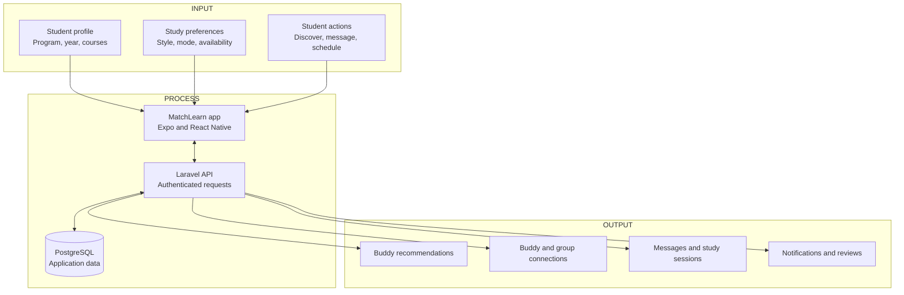
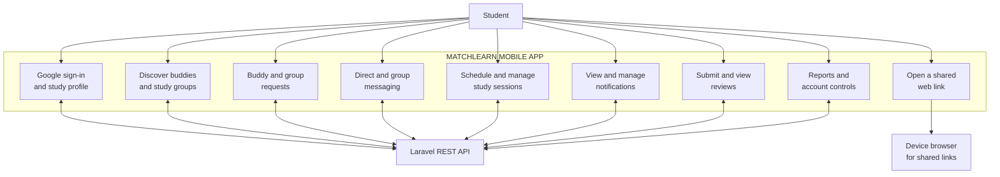
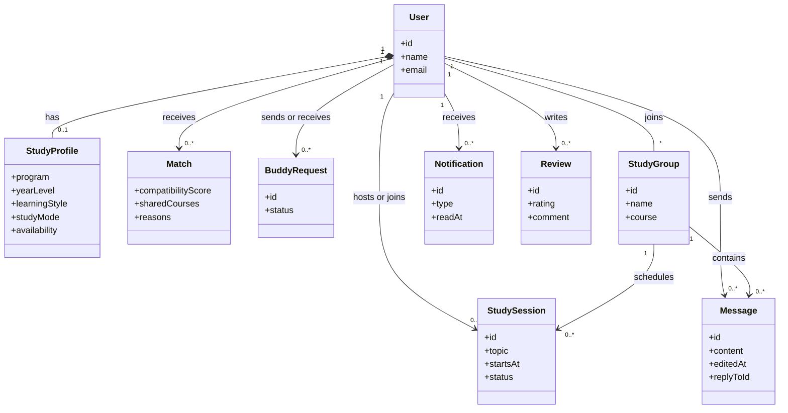
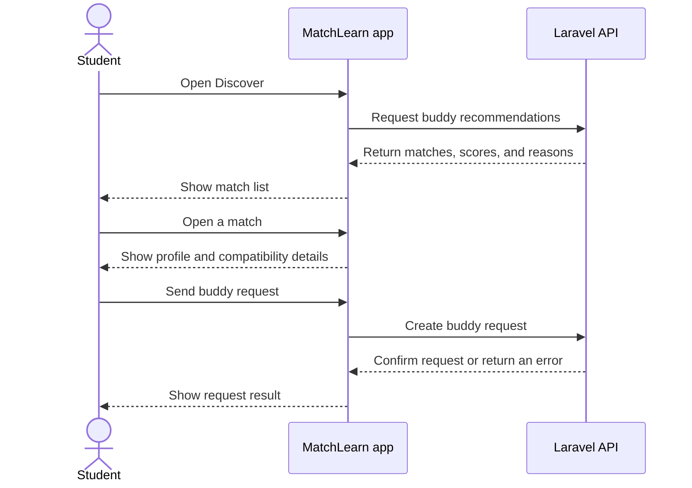
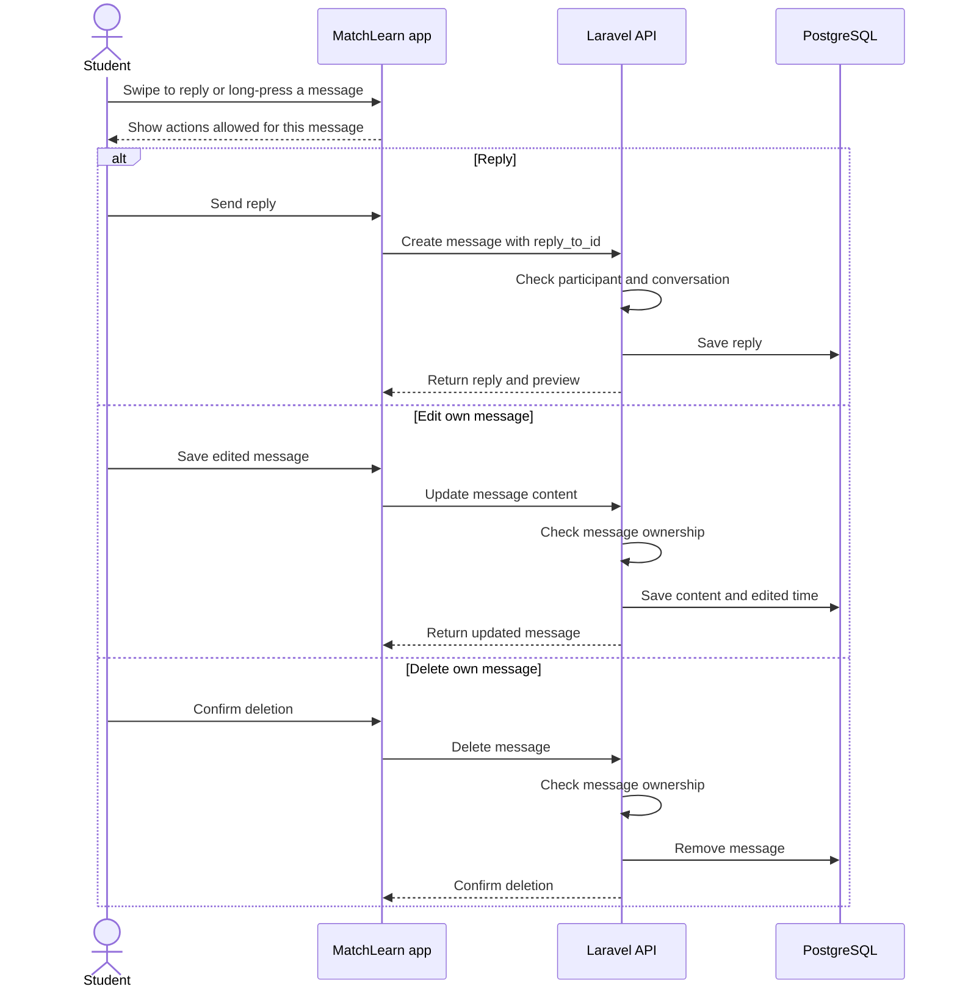
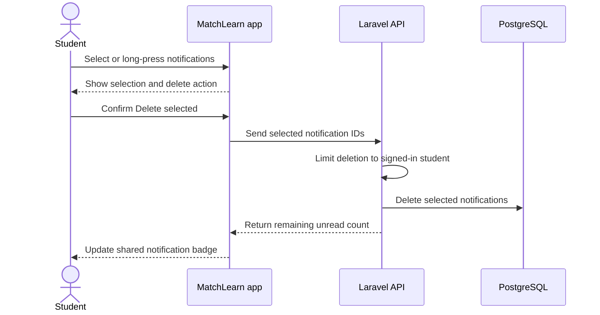
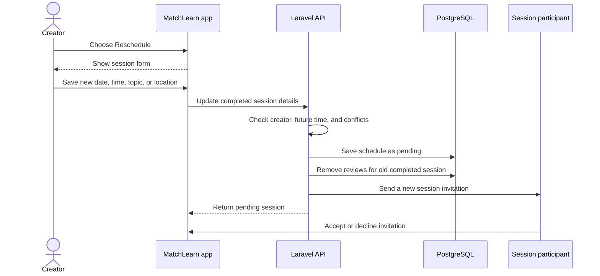
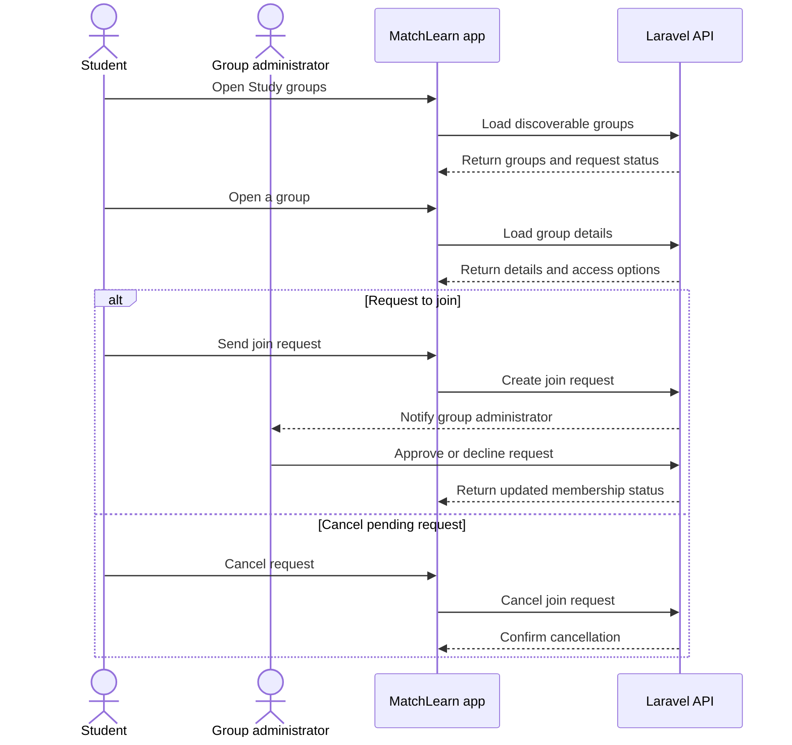
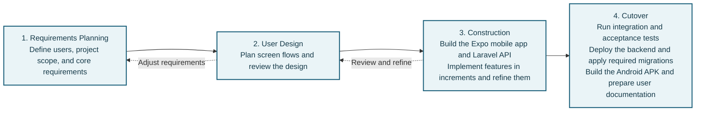

# MatchLearn Mermaid Diagrams

These diagrams describe the MatchLearn mobile app and Laravel API. Each diagram is kept focused so it is easier to read when rendered. Paste one fenced Mermaid block at a time into a Mermaid editor. The class diagram is conceptual, not a complete database schema.

## Project Schedule (Estimated Gantt Chart)

The task labels are shortened for readability; the dates follow the 2026 project schedule. Month-only axis labels and increased row spacing keep the chart clear. The final presentation is scheduled for 11 November 2026.

## 1. Conceptual Framework

## 2. Student Use Cases

## 3. Conceptual Class Diagram

## 4. Discover and Request a Buddy

## 5. Message Actions

## 6. Select and Delete Notifications

## 7. Reschedule a Completed Session

## 8. Discover and Join a Study Group

## 9. Rapid Application Development (RAD) Model

The dashed arrows show RAD's iterative refinement between phases. They describe the development model and do not claim a formal user-feedback or evaluation study.
