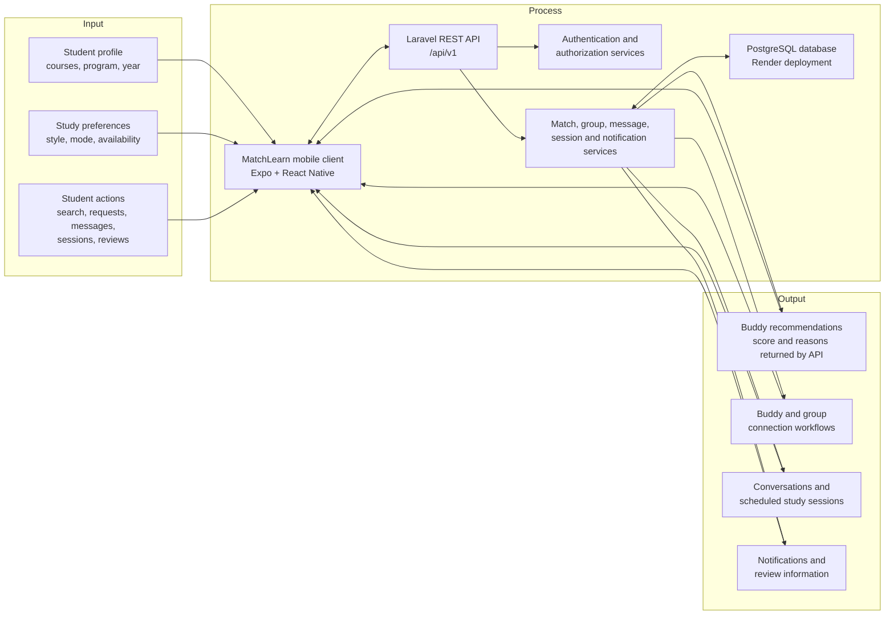
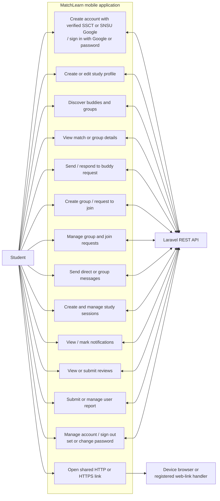
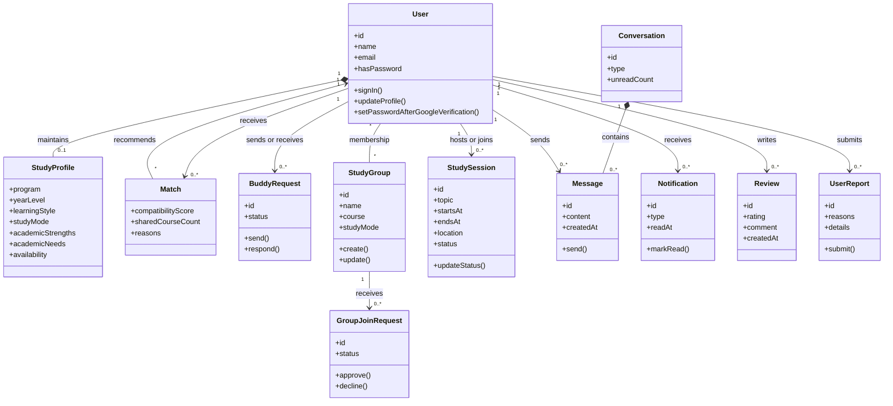
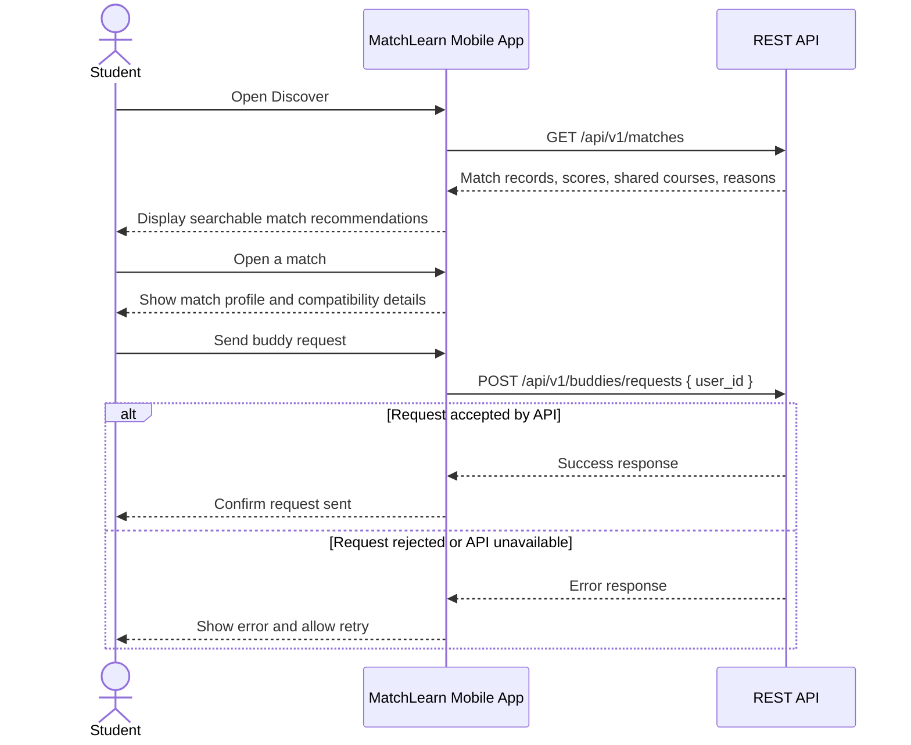

# MatchLearn Mermaid Diagram Source

These diagrams document the MatchLearn mobile application and its Laravel API. The class diagram is conceptual; it is not a complete backend database schema. Render with Mermaid-compatible tools or paste the code blocks into a Mermaid editor.

## 1. Conceptual Framework (Input–Process–Output)

## 2. Use-Case Diagram

## 3. Conceptual Class Diagram

## 4. Sequence Diagram: Discover Match and Send Buddy Request

