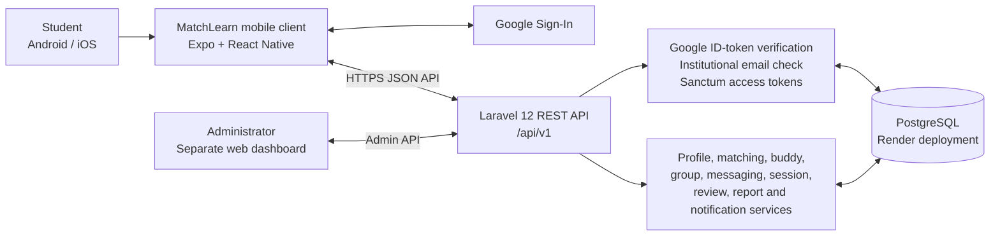
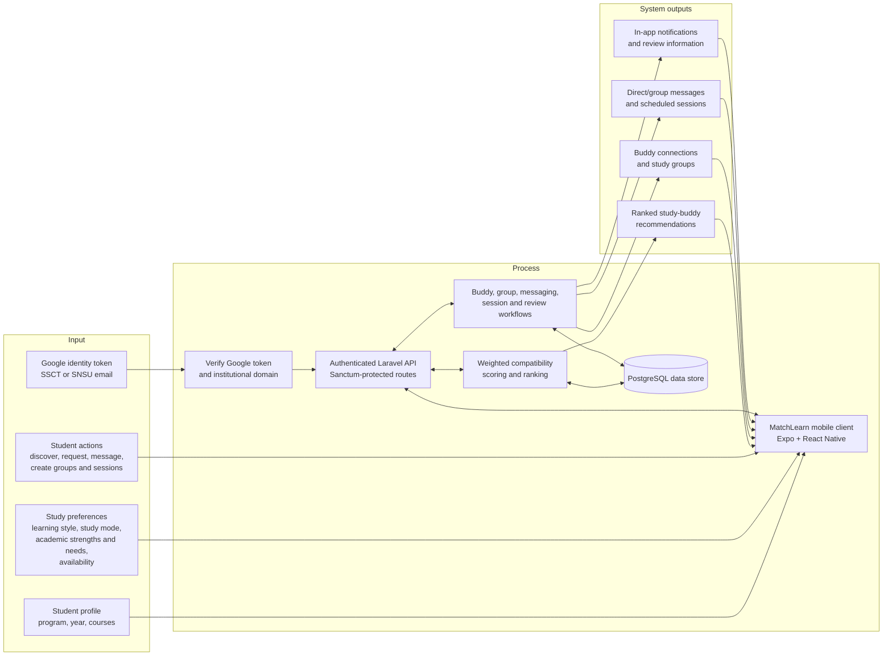
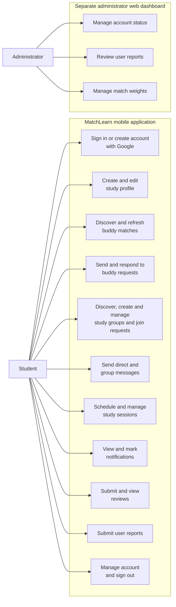
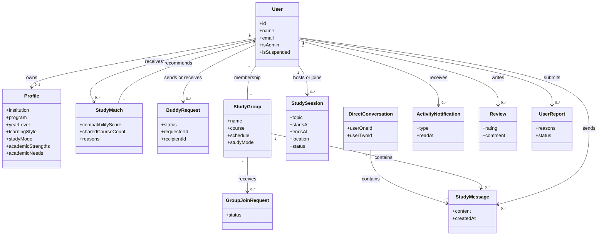
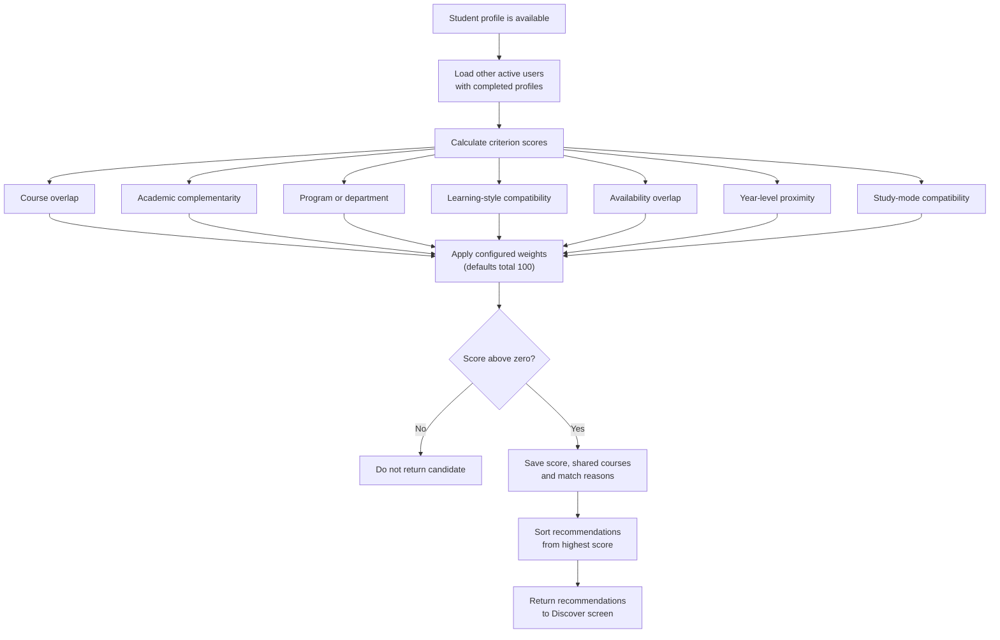
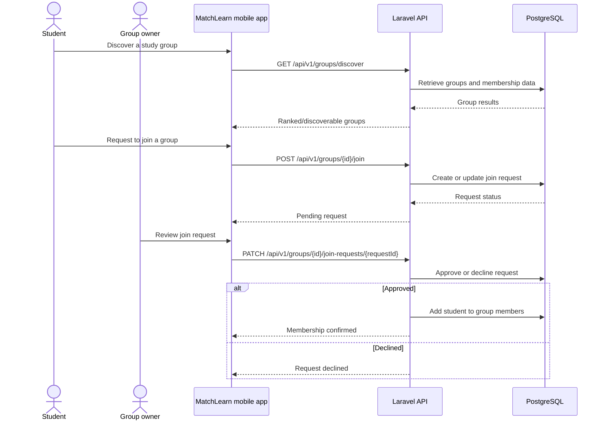

# MatchLearn Mermaid Diagram Source

These diagrams describe the implemented MatchLearn mobile application and its Laravel API. They are source diagrams in Mermaid syntax, not screenshots or claims about research outcomes. The matching weights shown are the backend defaults; administrators can change them, provided the weights total 100.

## 1. System Architecture



## 2. Conceptual Framework (Input–Process–Output)



## 3. Use-Case Diagram



## 4. Conceptual Domain Class Diagram



## 5. Google Sign-In and Account Creation

```mermaid
sequenceDiagram
    actor Student
    participant App as MatchLearn mobile app
    participant Google as Google Sign-In
    participant API as Laravel API
    participant DB as PostgreSQL

    Student->>App: Choose sign in or create account
    App->>Google: Request Google authentication
    Google-->>App: Return Google ID token
    opt New account
        Student->>App: Enter full name
    end
    App->>API: POST /api/v1/auth/google with ID token and optional name
    API->>Google: Verify ID token and claims
    Google-->>API: Verified email and identity claims
    API->>API: Check @ssct.edu.ph or @snsu.edu.ph domain
    API->>DB: Find existing account; create only for new account flow
    DB-->>API: User record
    API-->>App: Sanctum token and user data
    App->>App: Store token securely
    App-->>Student: Open MatchLearn
```

## 6. Match-Scoring Workflow



## 7. Study-Group Join Workflow


